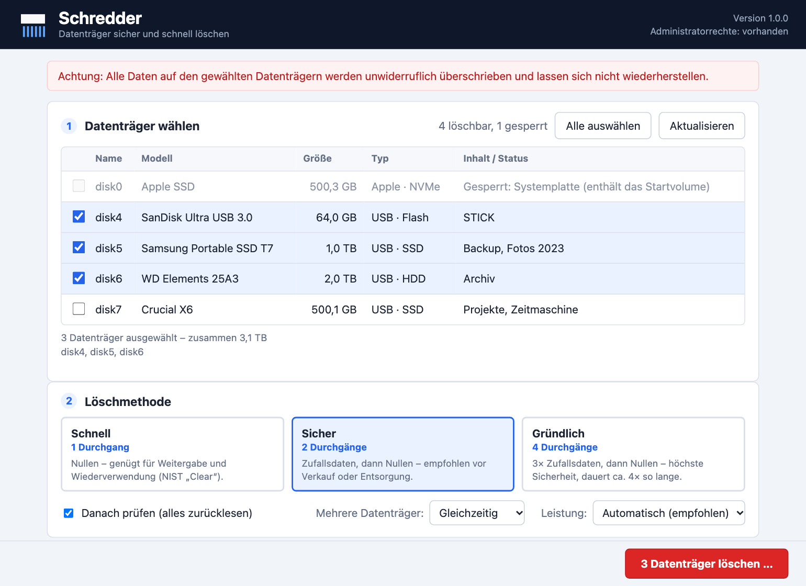
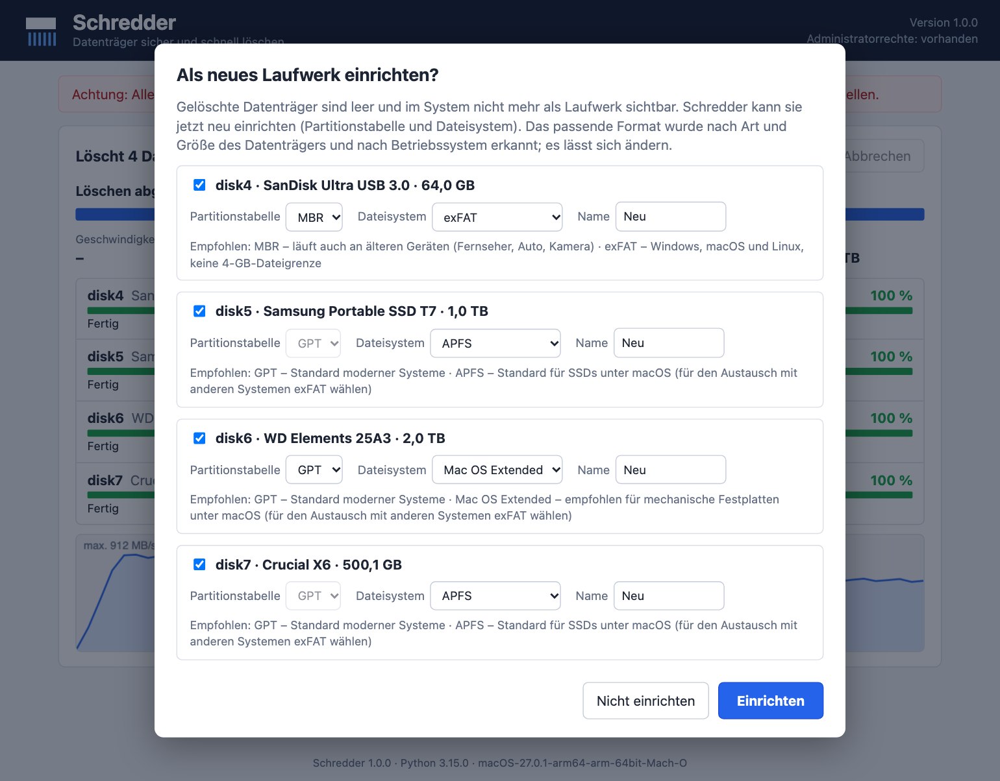
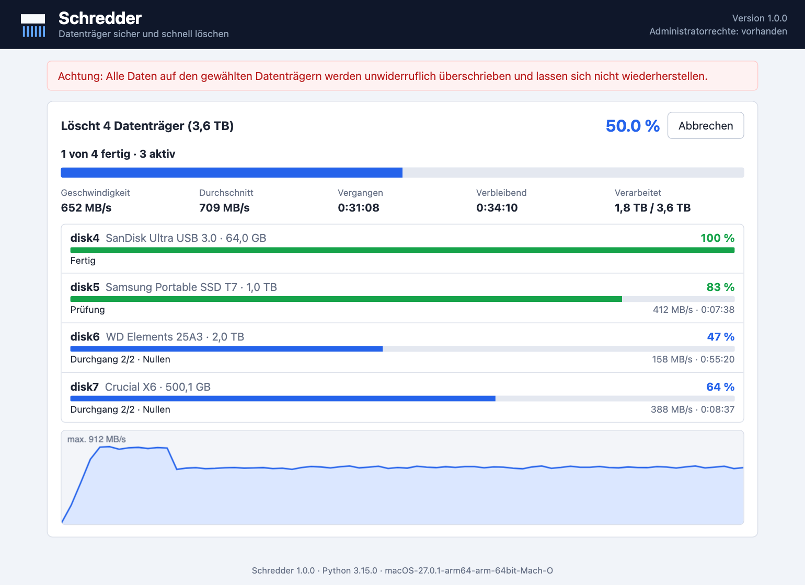

# Schredder

[](https://github.com/holgerdaehn/schredder/actions/workflows/ci.yml)
[](LICENSE)

Datenträger **sicher und schnell** löschen – für Windows, macOS und Linux, auch **mehrere Datenträger auf einmal**.
Eine kleine Anwendung mit Oberfläche im Browserfenster (läuft nur lokal auf dem eigenen Rechner), geschrieben in Python –
nur Standardbibliothek: kein `pip install`, kein Tk.



> **Warnung:** Alle Daten auf den gewählten Datenträgern werden unwiderruflich überschrieben.
> Nutzung auf eigene Gefahr (siehe [LICENSE](LICENSE)). Zuerst mit einem unwichtigen USB-Stick ausprobieren.

## Start

Repository herunterladen (`git clone https://github.com/holgerdaehn/schredder.git` oder auf GitHub *Code → Download ZIP*) und
im Ordner des eigenen Systems starten:

| System | Ordner | Start |
|---|---|---|
| Windows 10/11 | [`win/`](win) | Doppelklick auf `Schredder.bat` – installiert die neueste Python-Version bei Bedarf per `winget` |
| macOS | [`macos/`](macos) | Doppelklick auf `Schredder.command` (beim ersten Mal Rechtsklick → Öffnen) |
| Linux (Ubuntu) | [`linux/`](linux) | `./Schredder.sh` – installiert `python3` bei Bedarf per `apt` |

Voraussetzung: Python 3.9 oder neuer, **ohne** Tk. Die Startdateien wählen immer die **neueste** installierte
Python-3-Version (auch ganz neue wie 3.15) und fordern keine zusätzlichen Pakete an. Die Oberfläche öffnet sich in einem
eigenen Fenster (Microsoft Edge, Google Chrome, Brave oder Chromium, falls vorhanden), sonst im Standardbrowser; das Fenster
zu schließen beendet Schredder. Sie läuft **ohne** Administratorrechte; erst beim Start des Löschvorgangs fragt das System
(UAC, Passwortdialog, `pkexec`) **ein einziges Mal** nach der Berechtigung – auch bei mehreren Datenträgern. Nach dem
Download als ZIP ggf. `chmod +x Schredder.command` bzw. `chmod +x Schredder.sh` ausführen.

## Bedienung

1. **Datenträger wählen** – einen oder mehrere anhaken (oder „Alle auswählen“). Angezeigt werden Name, Modell, Größe, Typ
   und Inhalt (Laufwerksbuchstaben bzw. Volumes).
2. **Methode wählen**, optional die Prüfung und bei mehreren Datenträgern den Ablauf (gleichzeitig/nacheinander).
3. **Löschen …** klicken und bestätigen: bei einem Datenträger dessen Namen, bei mehreren deren Anzahl eintippen.
   Fortschritt, Geschwindigkeit und Restzeit werden je Datenträger und gesamt live angezeigt.
4. **Danach** fragt Schredder, ob die Datenträger **als neues Laufwerk eingerichtet** werden sollen (siehe unten). Ein
   **Löschprotokoll** (Textdatei, ein Abschnitt je Datenträger) lässt sich anschließend speichern.

| Methode | Durchgänge | Einsatz |
|---|---|---|
| Schnell | 1× Nullen | Weitergabe/Wiederverwendung (NIST SP 800-88 „Clear“) |
| Sicher | 1× Zufall, 1× Nullen | Verkauf, Entsorgung |
| Gründlich | 3× Zufall, 1× Nullen | höchste Sicherheit, ca. 4× so lange |

Alle Methoden enden mit einem Nullen-Durchgang. Die optionale **Prüfung** liest danach den gesamten Datenträger zurück
und meldet einen Fehler, sobald ein Byte ungleich 0 ist.

## Als neues Laufwerk einrichten

Ein gelöschter Datenträger ist leer und im System nicht mehr als Laufwerk sichtbar. Deshalb fragt Schredder nach dem Löschen,
ob er neu eingerichtet werden soll (Partitionstabelle + schnell formatiertes Dateisystem, eine Partition über den ganzen
Datenträger). Das passende Format wird nach Art und Größe des Datenträgers und nach Betriebssystem **automatisch erkannt**
und vorgeschlagen; Partitionstabelle, Dateisystem und Name lassen sich je Datenträger ändern. Es ist keine zweite
Rechte-Abfrage nötig, und nichts passiert ohne Bestätigung.



| Datenträger | Partitionstabelle | Dateisystem |
|---|---|---|
| USB-Stick / SD-Karte bis 32 GB | MBR (läuft auch an älteren Geräten) | FAT32 |
| USB-Stick / SD-Karte über 32 GB | MBR (über 2 TB: GPT) | exFAT |
| Festplatte / SSD / NVMe | GPT | Windows: NTFS · macOS: APFS (SSD/NVMe) bzw. Mac OS Extended (HDD) · Linux: ext4 |

Regeln: Über 2 TB immer GPT, FAT32 nur bis 32 GB, APFS nur mit GPT. Für Datenträger, die mit mehreren Systemen genutzt
werden, ist exFAT die beste Wahl. Unter Linux stehen exFAT und NTFS nur zur Auswahl, wenn `exfatprogs` bzw. `ntfs-3g`
installiert sind. Wer „Nicht einrichten“ wählt, kann den Datenträger später z. B. mit der Datenträgerverwaltung (Windows),
dem Festplattendienstprogramm (macOS) oder „Laufwerke“ (Linux) einrichten.

## Mehrere Datenträger

Standard ist **gleichzeitig**: Jeder Datenträger bekommt seinen eigenen Löschvorgang, alle laufen parallel unter einer
einzigen Berechtigung. Die Gesamtdauer entspricht dem langsamsten Datenträger statt der Summe aller; ein Fehler an einem
Datenträger stoppt die anderen nicht (jeder hat eigenen Status, eigene Fehlermeldung und eigenen Protokollabschnitt).
**Nacheinander** ist die Alternative für den Fall, dass alle Datenträger an einem schwachen USB-Hub hängen oder die
Stromversorgung knapp ist. „Abbrechen“ stoppt alle; noch nicht begonnene Datenträger werden dann gar nicht angefasst.



## Sicherheit

- **Ohne Rechte passiert nichts:** Der Löschprozess prüft als Allererstes, ob er mit Administrator-/Root-Rechten läuft.
  Wenn nicht, bricht er ab, bevor irgendetwas gelesen oder verändert wird („Es wurde nichts verändert“).
- **Erst prüfen, dann ändern:** Vor jeder Veränderung wird nicht zerstörend getestet, ob der Datenträger erreichbar,
  beschreibbar und nicht gesperrt ist (Windows zusätzlich: erster Sektor unverändert zurückschreiben). Erst danach folgt die
  Vorbereitung (Volumes aushängen bzw. unter Windows Partitionen entfernen) und das Schreiben. Scheitert danach doch etwas,
  nennt die Meldung genau den Zustand – z. B. „Partitionen bereits entfernt, Daten noch nicht überschrieben – bitte erneut
  starten“ – und der Vorgang lässt sich einfach wiederholen.
- **Systemplatte nie löschbar:** Der Datenträger mit dem Startvolume/System, interne Mac-Laufwerke und der Datenträger, auf
  dem Schredder selbst liegt, sind gesperrt (grau markiert, mit Grund) und lassen sich nicht mitauswählen.
- **Doppelte Prüfung:** Der privilegierte Worker prüft die Auswahl noch einmal (Name, Pfad, Größe, Modell, Seriennummer)
  und lässt einen Datenträger aus, der sich zwischenzeitlich geändert hat (z. B. Stick getauscht).
- **Bestätigung:** Löschen startet erst nach Eintippen des Datenträgernamens bzw. der Anzahl; der Server prüft das noch einmal.
- **Oberfläche nur lokal:** Der Server lauscht ausschließlich auf `127.0.0.1` an einem zufälligen Port. Jede Anfrage braucht ein
  zufälliges Token (steht nur im Link der eigenen Seite), Host und Herkunft werden geprüft (Schutz vor DNS-Rebinding und
  fremden Webseiten), eine strikte Content-Security-Policy verhindert eingeschleusten Code, und Namen von Datenträgern
  werden nie als HTML gedeutet.
- **Exklusiver Zugriff:** Volumes werden ausgehängt (macOS/Linux); unter Linux verhindert `O_EXCL`, dass das Gerät
  währenddessen von anderen genutzt wird.
- Der Rechner bleibt während des Löschens wach (kein Ruhezustand).

## Leistung

- **Ungepufferte Ein-/Ausgabe** ohne Umweg über den Dateicache: `O_DIRECT` (Linux), `FILE_FLAG_NO_BUFFERING` (Windows),
  Rohgerät `/dev/rdiskN` (macOS).
- **4-MiB-Blöcke, parallel:** Die Blöcke werden reihum auf mehrere Threads verteilt – viele gleichzeitige Anfragen für
  SSD/NVMe, trotzdem nahezu sequentielle Zugriffe für Festplatten. Automatisch: NVMe 8, SSD 4, HDD/USB 2 Threads je
  Datenträger (unter „Leistung“ änderbar; bei vielen gleichzeitigen Datenträgern begrenzt Schredder die Gesamtzahl).
- **Zufallsdaten ohne Engpass:** Pool aus dem Zufallsgenerator des Betriebssystems, jeder Block startet an einem
  zufälligen Versatz, ein Teil des Pools wird laufend erneuert. Kopieren und Vergleichen laufen ohne GIL.

## Grenzen

- **SSD/NVMe/USB-Sticks:** Wear-Leveling und überprovisionierte Bereiche können Restdaten behalten. Für höchste
  Sicherheit zusätzlich ATA Secure Erase / NVMe Sanitize des Herstellers nutzen.
- Versteckte Bereiche (HPA/DCO) und defekte, nicht mehr beschreibbare Sektoren werden nicht erfasst.
- Bei einem Schreibfehler bricht der betroffene Datenträger mit Fehlerposition ab (die anderen laufen weiter).
- **macOS:** Eventuell muss Terminal/Python unter Systemeinstellungen → Datenschutz & Sicherheit → *Festplattenzugriff*
  erlaubt werden.
- **Windows:** Beim Start fordert Windows per UAC Administratorrechte an. Die Partitionen werden mit `Clear-Disk`
  entfernt, der Datenträger ist danach „RAW“ und wird – wenn gewünscht – direkt von Schredder neu eingerichtet.
- **Linux:** Aktive LVM/RAID/verschlüsselte Volumes zuerst deaktivieren (sonst meldet `O_EXCL` „Gerät belegt“).
  Für die Rechteabfrage wird `pkexec` (PolicyKit) benötigt.

## Fehler melden

Bitte als [Issue](https://github.com/holgerdaehn/schredder/issues) mit Betriebssystem, Python-Version, der Fehlermeldung aus
dem Fenster und – falls vorhanden – dem Löschprotokoll (*Protokoll speichern …*). Unter Windows hilft zusätzlich die Ausgabe
von `Get-Disk` (PowerShell).

## Aufbau (für Entwickler)

```
src/common.py     Engine und Worker (für alle Systeme gleich)
src/web.py        lokaler Webserver: Schnittstelle zur Oberfläche, Auftrag, Fortschritt, Protokoll
src/ui.*          Oberfläche (HTML, CSS, JavaScript – ohne Bibliotheken und ohne Build-Werkzeuge)
src/posix.py      Gerätezugriff macOS/Linux
src/os_*.py       Betriebssystem-Teil: Datenträger auflisten, prüfen, vorbereiten, Rechte anfordern, Gerät öffnen
build.py          setzt daraus je eine eigenständige win|macos|linux/schredder.py zusammen (Oberfläche eingebettet)
tests/            Tests für Engine, Worker und HTTP-Schnittstelle (auf Dateien statt Datenträgern, ohne Browser)
.github/          CI: Build-Prüfung, pyflakes und Tests unter Linux, Windows und macOS mit Python 3.9 und der neuesten 3.x
                  (nur Standard-Runner, läuft mit Free-Konto)
```

Die `schredder.py` in den Systemordnern sind **generiert** – Änderungen in `src/` machen, dann `python3 build.py` ausführen
und die Dateien mit einchecken (`python3 build.py --check` prüft das, ebenso die CI). Tests: `python3 tests/test_schredder.py -v`.
Neue Python-Versionen müssen nicht angepasst werden: Es wird nur die Standardbibliothek genutzt, die CI prüft jeweils die neueste.
Änderungen pro Version stehen im [CHANGELOG](CHANGELOG.md).

Ablauf beim Löschen: Der lokale Server schreibt eine Auftragsdatei und startet eine Kopie des Programms mit `--worker` und
erhöhten Rechten. Der Worker prüft zuerst die Rechte, validiert die Datenträger, bearbeitet sie (parallel oder nacheinander),
meldet den Fortschritt über eine Statusdatei und reagiert auf eine Abbruchdatei.

## Lizenz

[MIT](LICENSE) – © 2026 Kundida (Holger Dähn)
